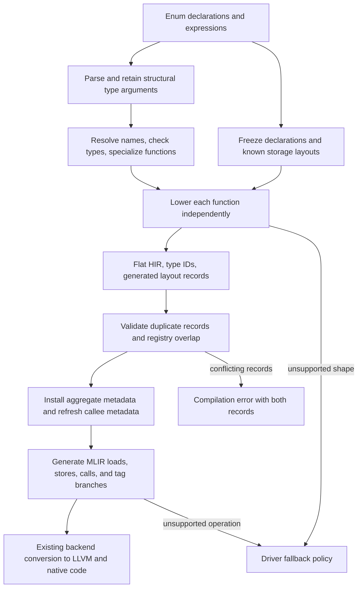

<!--
Part of the Vx Project, under the Apache License v2.0 with LLVM Exceptions.
See LICENSE for license information.
SPDX-License-Identifier: Apache-2.0 WITH LLVM-exception
-->

# Enum lowering: architecture, flow, and decisions

This document describes `enum-layout-records-step-one` through `783e3c10`, dated October 21, 2026.
It is a code walkthrough of the current branch. It does not mark future nested-layout work complete.
The source pointers below identify the current behavior.

## 1. The overall flow

The default compiler lowers checked syntax into a flat instruction stream called HIR, then generates MLIR from that stream.
Each function has its own worker and generated layout records. Module emission combines those records before generating function bodies.
A payload-free enum uses an `i32` tag. An enum with payloads uses an LLVM struct containing a tag and shared payload slots.
An empty variant of a payload enum still uses that aggregate representation.



The main entry points are [sequential build_flat_module](../../src/driver.rs#L1668), [parallel codegen_mlir_phase](../../src/pipeline.rs#L1934), and [emit_module_mlir](../../src/codegen/flat.rs#L1412).
The AST code generator remains a separate path. Section 11 explains its relationship to the default path.

## 2. Ownership of the information

| Information | Owner | Purpose and code pointer |
| --- | --- | --- |
| Constructor arguments and variant name | Syntax expression | [EnumVariantExpr](../../src/syntax/expr.rs#L66) retains `Vec<Type>` arguments alongside the display name. |
| Declaration parameters and ordered variants | Frozen registry | [EnumData](../../src/registry.rs#L81) retains declared payload types for substitution. |
| Complete nominal storage | Frozen registry | [build_frozen_registry](../../src/pipeline.rs#L812) creates layouts before function lowering. |
| Declaration identity and name ambiguity | Frozen identity table | [AggregateIdentities](../../src/layout/identity.rs#L43) provides stable declaration lookup to workers. |
| Flat operations and their result IDs | Function worker | HIR instructions refer to registers and the worker's type stream. |
| Concrete generated storage and payload metadata | Function worker | [LocalWorkerState::local_agg_layouts](../../src/session.rs#L124) transfers the records to module emission. |
| Validated storage and callable signatures | Emitter context | [AggLayout](../../src/codegen/flat.rs#L706) and [build_callee_map](../../src/codegen/flat.rs#L638) support allocation, access, and calls. |

**Decision: keep generated records local to workers.**
Concrete generic layouts depend on the arguments used by a function.
Workers calculate those layouts independently against the frozen registry.
They do not mutate a shared global layout cache while lowering bodies.
This preserves parallel compilation and makes disagreement visible at the module boundary.

The frozen registry does not calculate every payload enum's concrete storage.
[LayoutComputer::enum_layout](../../src/layout.rs#L421) returns a tag layout for payload-free declarations and leaves payload-carrying declarations unresolved there.
The registry also retains complete generic struct instances used by value.
Therefore, a generated ID's module component alone cannot prove that its storage is absent from the registry.

`EnumData` remains keyed by name. Declaration identity does not make every enum declaration table ID-keyed.
Distinct attached IDs can still retrieve the wrong enum payload declaration from that name-keyed table.
Migrating that table to declaration IDs remains a follow-up correctness task.

## 3. Preserve types before calculating storage

Parsing can initially represent `Choice<T>::Some(value)` as a function-like expression.
[parser: owner type arguments](../../src/parser/expr.rs#L596) retains the owner's arguments separately from a method's arguments.
The checker [rewrites a recognized variant call](../../src/hir/expr.rs#L287) into `EnumVariantExpr`, retaining the owner arguments.
It checks the payload through [check_enumvariant_expr](../../src/hir/check/literals.rs#L51).
It substitutes declaration parameters and gives literals the expected payload type.
For example, an integer literal in an `i32` payload must become an `i32` value before lowering.

[type argument name resolution](../../src/syntax/resolve.rs#L252) and [expression substitution](../../src/syntax/expr.rs#L1363) preserve structural arguments through name resolution and specialization.
[enum_construct_type](../../src/hir/flatten.rs#L6275) reconstructs the constructor's type from those arguments.
It uses the display name to identify the base, without reparsing printed generic arguments.
A generic-looking constructor without recoverable structural arguments declines.
The checker still contains a compatibility parser for compiler-generated expressions that initially carry only a name.

**Decision: the structured type is authoritative for generic arguments.**
Printed names can omit placement, borrow information, or nested type structure.
Reparsing them can make construction, matching, and function signatures disagree about the same instance.
Structural arguments keep this information available through all three stages.

Function specialization needs a compatible rule too.
[function specialization](../../src/hir/env.rs#L1511) uses [specialization_type_name](../../src/syntax/identity.rs#L153) to retain placement and its position within a type tree.
Otherwise, two functions using different tensor placements could incorrectly share one specialization.

## 4. Identify the declaration and the concrete instance

[enum_instance_gid](../../src/hir/flatten.rs#L80) hashes the resolved declaration ID and semantic keys for its concrete arguments.
The generated ID uses module zero and an enum-specific hash prefix.
A non-generic payload enum uses the same scheme with an empty argument list.
Signatures and bodies can therefore calculate the same instance ID independently.

Typed lookup follows these rules:

1. An attached, known declaration ID is authoritative, including under an alias spelling.
1. An unknown attached ID declines. It cannot select another declaration with the same name.
1. A bare name must identify one declaration. An incomplete declaration still counts toward ambiguity.
1. Value storage must be complete. A pointer target can retain its declaration ID without a complete layout.

See [AggregateIdentities](../../src/layout/identity.rs#L43), [nominal_layout_id](../../src/registry.rs#L549), and [Lowerer::known_aggregate_id](../../src/hir/flatten.rs#L3217).
Constructor syntax still identifies its base through the enum name and retains its arguments separately.
The attached-ID rules apply where a typed nominal base is available.

**Decision: use semantic type keys, not source representations.**
[aggregate_type_key](../../src/layout/identity.rs#L234) retains nominal declaration IDs, dimensions, placement, mutability, memory spaces, and wrapper kinds.
It excludes source spans and function-local borrow-region numbers.
Local region numbers differ between workers without changing the represented enum type.
Access permissions and placement remain meaningful distinctions, so the key retains them.
Unsupported type-level expressions return no key instead of receiving an approximate identity.
Tagged nodes and length-delimited leaf values are appended to one encoding buffer.
Completed child strings are never recursively escaped. This keeps encoded size linear in the type or expression tree.
Stress tests bound encoded size and retain distinctions between deeply nested leaf types and names.

[normalize_type](../../src/layout/identity.rs#L115) applies the same rules to metadata retained in generated records.
[GeneratedAggregateLayout::semantically_eq](../../src/layout.rs#L59) compares semantic payload keys, physical fields, sizes, alignments, and aggregate metadata.
A different display name alone does not establish a conflict.

## 5. Resolve payloads and calculate storage

[Lowerer::enum_instance_layout_of](../../src/hir/flatten.rs#L3482) performs these steps:

1. Resolve the base declaration and calculate the concrete instance ID.
1. Reuse a completed record from the current lowerer when available.
1. Substitute concrete arguments into every variant's payload types.
1. Resolve every present payload through [Lowerer::payload_field](../../src/hir/flatten.rs#L3443).
1. Calculate shared slot requirements through [enum_storage_layout](../../src/layout.rs#L222).
1. Select physical fields and retain each variant's actual payload metadata.
1. Record the completed layout for transfer to the emitter.

**Decision: any unsupported present payload declines the complete layout.**
A variant with no value at a position contributes no requirement.
A present value with no supported layout must not be treated as absent.
Skipping it could allocate too little storage and still produce apparently valid code.
This rule applies to every variant and every payload position.

Payload resolution supports numbers, pointer-like values, complete declared structs, and supported generic struct instances.
Payload-free enums use their `i32` representation.
[Lowerer::struct_instance_layout_of](../../src/hir/flatten.rs#L3265) reuses complete registry storage when possible and substitutes declared types to retain semantic metadata.
A nested value's aggregate metadata follows its resolved storage ID.
Pointer metadata follows the pointee identity without requiring recursive expansion of the pointee's storage.

### Independent size and alignment

There is one shared slot for each payload position across variants.
For position `p`, the calculation is:

```text
alignment[p] = maximum alignment of all values present at p
capacity[p]  = round_up(maximum size of values present at p, alignment[p])
offset[p]    = round_up(end of preceding field, alignment[p])
enum_align   = maximum of 4 and all slot alignments
enum_size    = round_up(end of final slot, enum_align)
```

The tag occupies four bytes at offset zero with alignment four.
[enum_storage_layout](../../src/layout.rs#L222) checks arithmetic overflow, valid power-of-two alignments, and whether the final size fits host indices.

**Decision: maximize size and alignment independently.**
Selecting the largest `(size, alignment)` pair loses alignment when different variants supply the two maxima.
A 12-byte value aligned to 4 and an 8-byte value aligned to 8 need a 16-byte slot aligned to 8.

For two variants that also carry a later `i32`, the layout is:

| Field | Offset | Capacity | Alignment |
| --- | ---: | ---: | ---: |
| Tag | 0 | 4 | 4 |
| Shared payload position 0 | 8 | 16 | 8 |
| Shared payload position 1 | 24 | 4 | 4 |
| Complete enum, including tail padding | — | 32 | 8 |

This representation uses separate shared positions.
Two variants with large values at different positions reserve both large slots.
It can therefore occupy more space than a union over complete variant payloads.
Compact enum storage is a separate optimization.

### Choose physical storage

Every nonempty shared slot uses integer or byte-array storage from `enum_slot_storage`.
A slot's payload representative cannot establish a safe storage type.
A `bool` field preserves only one bit, and a padded struct leaves gaps where another variant may store meaningful data.
Equal size and alignment do not prevent either form of information loss during arguments, returns, or whole-value copies.

Alignments 1, 2, 4, and 8 use integer alignment fields. Alignment 16 uses `vector<2xi64>`.
When capacity exceeds that alignment field, a byte-array tail occupies every remaining carrier byte.
Alignment and padding remain inside one physical LLVM field for the logical payload position.
Unsupported carrier requirements decline.
Zero-sized slots use a zero-length array of the corresponding integer alignment field.

**Decision: the complete carrier preserves every payload byte.**
Whole-enum copies use the physical storage type.
The carrier therefore cannot contain sub-byte fields or padding that discards another variant's data.
Wrapping its alignment field and byte-array tail keeps payload position `p` at physical field `p + 1`.
Actual payload types, aggregate IDs, and pointer targets remain exclusively in variant access metadata.
Shared carrier fields have no variant-specific aggregate or pointer identity.

Zero-sized logical positions remain in the layout even when offsets coincide.
Explicit payload loads preserve their field identity. Offset-based stores still need separate consideration for broader zero-sized nested layouts.

## 6. Separate storage metadata from variant metadata

[GeneratedAggregateLayout](../../src/layout.rs#L35) carries a concrete ID, display name, size, alignment, physical fields, and variant payloads.
[GeneratedFieldLayout](../../src/layout.rs#L49) describes each physical field.
[GeneratedPayloadLayout](../../src/layout.rs#L121) describes each actual value a variant places in a shared slot.
Its `aggregate_id` identifies a value stored by value. Its `pointer_target_id` identifies an aggregate reached through a pointer.
[Lowerer::payload_metadata](../../src/hir/flatten.rs#L3244) constructs those semantic payload records.

**Decision: a shared carrier does not define every variant's value type.**
The same slot can hold an integer, a pointer, or different supported aggregates.
Its physical LLVM type cannot supply the right load type and pointee metadata for every variant.
The record therefore retains `variant_payloads[variant][position]` separately from storage fields.
This also prevents one variant's pointer target from being reused for another variant.

## 7. Lower construction, matching, and iteration

### Construction

[Lowerer::lower_enum_construct](../../src/hir/flatten.rs#L3050) allocates a slot for the complete enum instance.
It stores the variant's zero-based declaration ordinal in the tag field.
It then stores each active payload at that position's calculated byte offset.
A newly constructed aggregate payload first needs `SlotLoad` to obtain its value from its construction slot.
An empty variant writes only the tag. Inactive payload storage remains uninitialized.

[FnEmit::op_field_store](../../src/codegen/flat/emit/aggregate.rs#L19) generates a field address from the physical aggregate layout.
For enum payloads, it chooses the store type from the actual value register:

- A pointer stores as `!llvm.ptr`.
- A scalar stores at its scalar type.
- An aggregate value stores at its own aggregate storage type.
- Tensor descriptors follow their separate descriptor handling.

**Decision: store the value's type, rather than assuming the carrier's type.**
Opaque LLVM pointers allow the same field address to receive different supported variant types.
An integer carrier must not cause a pointer payload to be stored as an integer instruction operand.
The slot calculation already establishes capacity and alignment for the active value.

### Matching

[Lowerer::lower_data_match](../../src/hir/flatten.rs#L2273) uses the subject's concrete type to find its enum layout.
[Lowerer::lower_data_match_slot](../../src/hir/flatten.rs#L2242) reuses a local slot or a borrowed pointer, or spills an aggregate value into a temporary slot.
Tag loads use ordinary `FieldLoad` with a byte offset.
Comparisons and branches select an arm before its payload values are loaded.

Payload reads use `EnumPayloadLoad`:

```text
operand1 = enum slot register
operand2 = 0
type_idx = result type in the worker's type stream
imm      = variant_index | (payload_position << 32)
```

[EnumPayloadIndex](../../src/bytecode.rs#L299) defines the encoding. [verify_hir_stream](../../src/hir/flatten.rs#L6567) checks the unused second operand and register-use rules.
The emitter reads variant metadata through [FnEmit::op_field_load](../../src/codegen/flat/emit/aggregate.rs#L117) and addresses physical field `payload_position + 1`.
It restores pointer flags, pointer targets, aggregate value IDs, and scalar types for later operations.

**Decision: put variant and payload identity in a dedicated instruction.**
An ordinal is metadata, not a register reference.
Keeping it outside register operands prevents verification and temporary cleanup from treating it as a live value.
A byte offset alone also cannot distinguish logical fields that share an offset.
`FieldStore` and ordinary struct accesses still use offsets. This change does not replace all aggregate field addressing.

Iterator lowering also uses explicit enum payload reads for the `next()` result. See [iterator lowering](../../src/hir/flatten.rs#L2709).
Nested payload bindings still use the free `lowered_ty` helper in matching, which cannot synthesize arbitrary nested layouts.

## 8. Merge worker records before emitting functions

The sequential driver and parallel pipeline collect the same `GeneratedAggregateLayout` records.
See [sequential build_flat_module](../../src/driver.rs#L1668) and [parallel codegen_mlir_phase](../../src/pipeline.rs#L1934).
[emit_module_mlir](../../src/codegen/flat.rs#L1412) builds the emitter context and installs those records before calculating complete function signatures.

[EmitCtx::install_generated_layouts](../../src/codegen/flat.rs#L1234) validates all records before changing the context:

1. Compare a record with complete registry storage when their IDs overlap.
1. Compare repeated generated records with the same ID using semantic equality.
1. Reject conflicts with both complete records in the diagnostic.
1. Install storage and metadata only after every comparison succeeds.

[EmitCtx::registry_layout_agrees](../../src/codegen/flat.rs#L1183) checks physical fields, LLVM field types, sizes, alignment, and available aggregate and pointer metadata.
An incomplete registry entry can gain generated storage.
A complete registry entry cannot be silently replaced by contradictory storage.

**Decision: disagreement is a compilation error.**
An unsupported shape can permit fallback. Conflicting records mean two parts of the compiler disagree about one identity.
Choosing whichever worker finishes first would make behavior depend on scheduling.
Validation therefore precedes installation and preserves the context on failure.

### Refresh the right maps

[build_agg_names](../../src/codegen/flat.rs#L613) only examines registry IDs that also have storage in the emitter.
Replacing existing storage leaves that set unchanged.
Adding generated IDs outside the registry also leaves it unchanged.
Those cases retain the existing name map.

A registry ID that gains usable storage can add a name or make an existing name ambiguous.
That case rebuilds names before refreshing callees.
Every nonempty installation refreshes [build_callee_map](../../src/codegen/flat.rs#L638), because calls can now return a generated aggregate or a pointer to one.

**Decision: test actual registry overlap when skipping a rebuild.**
Module-zero generated IDs alone are insufficient evidence.
The relevant condition is a registry ID absent from the emitter before installation.
This avoids a full name-map reconstruction on the usual generated-instance path while retaining the completion case.

## 9. Calls, returns, and drops

Enums use the ordinary aggregate machinery once their storage and metadata are installed.
[FnEmit::op_slot_load](../../src/codegen/flat/emit/memory.rs#L171) loads complete aggregate values from slots.
[FnEmit::op_call](../../src/codegen/flat/emit/call.rs#L27) uses callee aggregate IDs for by-value results and pointee IDs for pointer results.
Matching a returned aggregate can spill it to a slot before addressing its fields.
The emitter's `agg_of` tracks an addressable aggregate, while `agg_val_of` tracks an aggregate value.
Confusing these would store an address where the program expects the enum's value.

Ownership cleanup starts in the checker, before flat lowering.
[TypeChecker::drops_enum_glue](../../src/hir/check/drops.rs#L541) calculates cleanup for the active variant, and [payload_match](../../src/hir/check/drops.rs#L335) constructs the corresponding payload match.
Generated layout records describe representation. They do not independently establish correct moves or drops.

There is an existing cleanup restriction when variants mix scalar-like and aggregate payload kinds at one position.
`drops_enum_glue` returns no glue for that case because of legacy generator limitations.
The source documents the resulting leak. The layout-record changes do not remove that restriction.
Nested-owner cleanup remains separate validation work.

## 10. Current limits and artifact compatibility

[Lowerer::payload_field](../../src/hir/flatten.rs#L3443) does not provide unrestricted recursive layout resolution.
An enum inside another payload enum, or a plain struct whose enum field leaves registry storage incomplete, can still decline.
Some generic structs containing enums already have a specialized resolution path in [Lowerer::struct_instance_layout_of](../../src/hir/flatten.rs#L3265).
That path does not establish general nested-enum support.
Similarly, [Lowerer::lower_ty_synth](../../src/hir/flatten.rs#L3118) handles supported concrete instances without making the free `lowered_ty` helper a recursive layout resolver.

Do not skip unsupported fields, substitute a smaller layout, or read inactive payloads to extend this support.
Future changes must preserve the storage contract, variant metadata, and conflict checks together.

[VXLIB_FORMAT_TAG](../../src/metadata.rs#L98) currently identifies `vxlib-interface-v17`.
The explicit payload opcode, revised carriers, and structural key encoding require one format bump from main’s v16.
Older interface versions are rejected. Affected module artifacts and compiled objects require rebuilding.
Version compatibility does not establish complete export dependencies.
Exported bodies currently omit their generated layout records, so importing an enum-using body can fail even with scalar public signatures.
Completing that artifact transfer remains follow-up work.
This implementation does not establish a stable external C ABI for all enum types.

## 11. AST fallback is a separate implementation

[driver fallback policy](../../src/driver.rs#L1396) attempts flat code generation by default. `--legacy-codegen` selects the AST path.
Unsupported flat operations can permit AST fallback when the driver allows it.
`VX_NO_AST_FALLBACK` rejects that fallback, while `VX_FLAT_DBG=1` makes the selected path visible.
Interface imports also restrict fallback because the AST generator cannot link functions available only through `.vxlib` bodies.
Layout conflicts remain errors instead of becoming fallback requests.

The legacy generator calculates its own slot types through [legacy enum_payload_slot_ty](../../src/codegen/generator.rs#L1936).
[legacy EnumVariantExpr lowering](../../src/codegen/lower/expr.rs#L4218) creates aggregate values with `llvm.insertvalue` and fits payloads to those slot types.
[legacy MatchExpr lowering](../../src/codegen/lower/expr.rs#L3993) handles matching through the AST path.
This path still recovers some generic information from printed names and has different payload-shape restrictions.
It does not consume the flat worker's shared layout records.

**Decision: preserve an explicit boundary between the implementations.**
A program compiling through fallback does not prove that its shape works through flat lowering.
Nor does successful compilation establish native value correctness.
The architecture described above is the default flat path. Unifying the two layout implementations remains separate work.

## 12. Evidence and extension points

| Contract | Regression pointers |
| --- | --- |
| Semantic identity and nominal declarations | [identity tests](../../src/hir/flatten/tests.rs#L256) |
| Storage metadata stays separate from active variant types | [variant metadata tests](../../src/hir/flatten/tests.rs#L1328) |
| Actual LLVM storage meets size, alignment, and offset requirements | [LLVM storage checks](../../src/codegen/flat.rs#L2674) |
| Conflicts leave maps and metadata unchanged | [atomic installation tests](../../src/codegen/flat.rs#L3139) |
| New generated storage refreshes callees without rebuilding unchanged names | [name-map and callee tests](../../src/codegen/flat.rs#L3312) |
| Mixed pointer and integer payloads retain their actual value types | [mixed pointer and integer tests](../../tests/integration_test/flat_codegen_differential.rs#L1592) |
| Both variant orders, later payloads, calls, returns, and empty variants | [native alignment tests](../../tests/integration_test/flat_codegen_differential.rs#L4143) |
| Unsupported nested payloads cause a controlled decline | [unsupported payload tests](../../tests/integration_test/flat_codegen_differential.rs#L1412) |

Native regression helpers check the flat-path marker and expected values in normal and parallel compilation.
The alignment fixture also runs at `-O0` and `-O2`.
These regression checks do not establish completion of every nested-layout or ownership task.

For future nested-layout work, start at payload resolution and match binding resolution.
For a new physical carrier, update the storage calculation and prove its LLVM layout.
For a new access encoding, update bytecode, verification, register-use analysis, and artifact compatibility together.
For a new semantic type distinction, update identity, retained metadata, comparison, and function specialization consistently.
