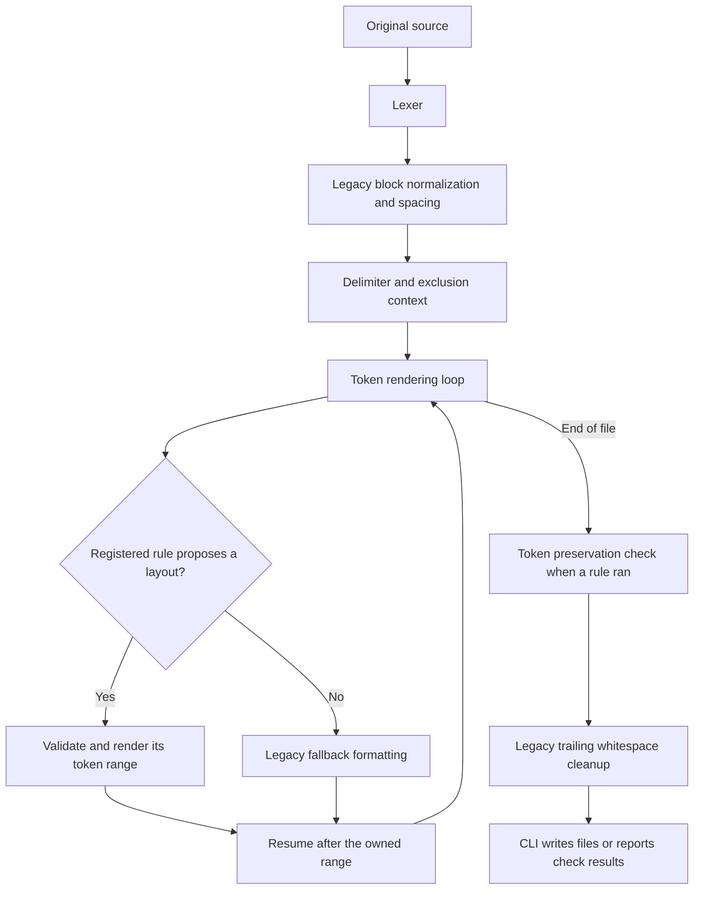
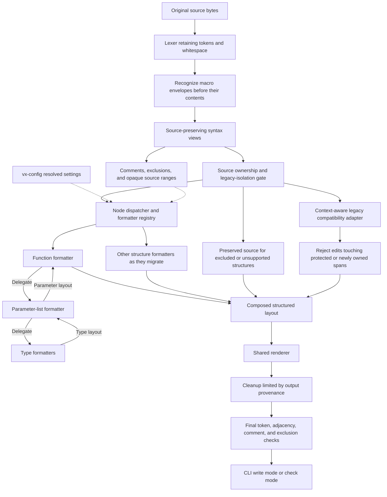
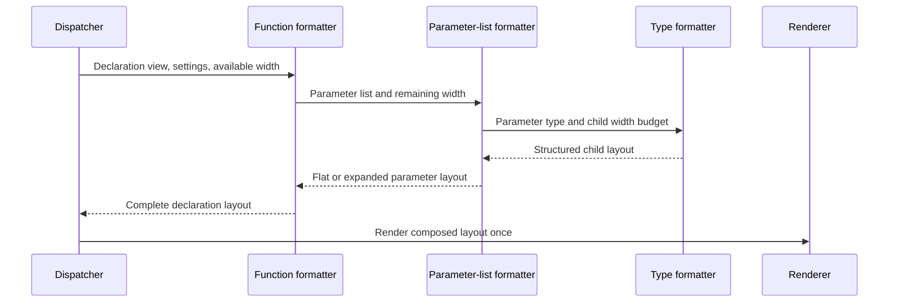

# Proposal: syntax-aware architecture for vx-format

Status: design proposal for the follow-up syntax-aware formatter.
This branch adds configuration and CI checks using the existing formatter engine.
The syntax engine and its implementation guides belong to a separate PR.

The unsupported-syntax warning policy below was selected on 2026-10-29.
Coverage outcomes and nonfatal syntax warnings are part of the proposed engine.

Prepared on 2026-10-29 for [issue 2343](https://github.com/vx-lang/Vx/issues/2343).

## Decision to review

Keep the configuration library, structured layout output, renderer, and preservation checks.
Change formatter dispatch from token positions to explicit source-syntax structures.
Let parent formatters delegate nested structures to child formatters with a shared width budget.

Start with a function-declaration view over the original source.
Keep a path toward a complete syntax tree without requiring that investment immediately.
Do not add more independent declaration scanners before reviewing this boundary.

This proposal changes the internal architecture.
It does not propose new formatting styles, configuration keys, lint rules, or external plugins.
Existing formatting behavior should remain stable during the first migration steps.

## Earlier token-rule prototype

This section records the prototype architecture that motivated the proposal.
The listed token-position modules describe that prototype, not this branch's implementation.
The proposed replacement uses syntax roots, bounded legacy intervals, and final preservation validation.

The prototype tokenizes source, applies legacy normalization and spacing passes, then renders tokens.
The rendering loop consults registered rules at eligible token positions.
Function-signature formatting is the first registered rule.
Whole-file exclusions and unknown lexer tokens can return the source unchanged before the later passes.



The prototype divides responsibilities between the following files:

| File | Prototype responsibility |
| --- | --- |
| `src/formatter.rs` | Legacy passes, token traversal, rule invocation, and fallback rendering. |
| `src/formatter/context.rs` | Shared delimiter matching, exclusions, settings, and current output position. |
| `src/formatter/registry.rs` | Rule registration, eligibility, names, and execution order. |
| `src/formatter/layout.rs` | Token-and-whitespace instructions and replacement validation. |
| `src/formatter/renderer.rs` | Rule-output rendering and lexical token validation. |
| `src/formatter/rules/function_signatures.rs` | Recognizing declarations and choosing their layout. |
| `vx-config/src/lib.rs` | Formatter configuration discovery, parsing, defaults, and overrides. |

The prototype establishes useful boundaries.
Rules have no direct file access or mutable output buffer.
Duplicate names and competing proposals cause assertions.
The plan checks token order and complete delimiter pairs.
The renderer checks for accidental lexical token merging.

Lexical equality alone does not protect whitespace-sensitive grammar.
The parser recognizes shifts from adjacent angle tokens and macro invocations from an adjacent identifier and `!`.
The current framework does not explicitly validate those adjacency relationships.

However, one accepted replacement owns its entire range.
Other rules do not run independently inside that range.
The signature rule must recognize declarations and format their internal spacing itself.

The token check currently precedes legacy trailing-whitespace cleanup.
It does not establish preservation of the final output after that cleanup.
Exclusion protection in the rule framework also does not cover every earlier legacy transformation.
The target architecture should apply preservation guarantees across the complete pipeline.

The initial implementation compiled tests without execution.
The later activation work executes baseline, contract, and CLI tests with deliberate regression checks.

## Why the token-rule model becomes expensive

### Repeated recognition of language syntax

A token sequence identifies punctuation and words without identifying their grammatical roles.
Matching parentheses cannot distinguish function parameters, call arguments, tuple types, and grouped expressions by itself.

Each substantial rule would need more surrounding context.
Separate scanners could disagree about generic arguments, comments, attributes, or new language constructs.
Over time, these scanners would form an informal parser distributed across rule modules.

Central syntax recognition gives formatters one interpretation of the source.

### Nested layout does not fit independent range ownership

A function formatter owns a signature containing parameter types.
A future type formatter might need to wrap a generic or tuple type inside that signature.
The current traversal skips that inner range after accepting the function rule.

Calling the type formatter first does not solve the general problem.
The function formatter still needs to choose a complete layout using the child's resulting width.
Running repeated passes could require several invocations to reach stable output.

The target design should compose nested layouts during one formatting operation.

### Width decisions need shared context

Consider this declaration:

```vx
fn combine(first: Tensor<f32, [64, 64]>, second: Tensor<f32, [64, 64]>) -> i32 {
  return 0;
}
```

The parameter formatter needs less space than the whole declaration.
Indentation, the function name, separators, and the return type consume part of the available width.

Independent rules can count the same space differently.
A parent should assign space to each child and select a complete layout from the results.

### Comments require ownership

The current signature rule declines declarations containing comments.
That conservative policy prevents some unsafe rewrites, but limits useful formatting.

Broader support needs answers to these questions:

- Does a comment belong before a parameter or after the previous parameter?
- Does an end-of-line comment require the following token to stay on another line?
- Does a comment describe a list, its closing delimiter, or one element?
- Which original bytes must remain untouched inside an excluded region?

These decisions should live in shared syntax and comment services.
Every rule should not rediscover them.

### Conflict detection does not define composition

An overlap assertion identifies an implementation conflict.
It cannot decide which formatter owns a nested construct or how two layout decisions should combine.

Explicit parent-child relationships provide that ownership.
Registration should select the formatter for a structure, rather than let several scanners compete for the same text.

## What Rustfmt provides as a reference

Rustfmt uses the Rust compiler's syntax tree before macro expansion.
A visitor handles top-level traversal and delegates to structure-specific rewrite implementations.
Those implementations can format their children recursively.
Source spans recover text and comments that the syntax tree does not retain directly.
See the [Rustfmt architecture guide](https://github.com/rust-lang/rustfmt/blob/main/Contributing.md#a-quick-tour-of-rustfmt).

Its `Rewrite` interface receives shared context and a `Shape`, then returns formatted text or a formatting failure.
The context includes configuration and source access.
`Shape` tracks width, indentation, and offset.
See [rewrite.rs](https://github.com/rust-lang/rustfmt/blob/main/src/rewrite.rs) and
[shape.rs](https://github.com/rust-lang/rustfmt/blob/main/src/shape.rs).

The useful architectural lesson is recursive formatting with explicit space budgets.
Our registry and structured layout instructions are Vx design choices.
They are not copies of a Rustfmt plugin registry or its string-returning rewrite interface.

Rustfmt also checks expected output and repeated-formatting stability.
Those validation practices matter independently of the representation we choose.
See [its testing guide](https://github.com/rust-lang/rustfmt/blob/main/Contributing.md#create-test-cases).

## Options

| Option | Benefit | Cost or limitation |
| --- | --- | --- |
| Keep token-position rules | Lowest immediate migration cost; useful for simple local whitespace rules. | Grammar recognition and nested layout remain distributed across rules. |
| Use the compiler's current transformed AST | Reuses recognized declarations and types. | Source distinctions and comments are incomplete; current parsing already rewrites some syntax. |
| Build source-preserving syntax views incrementally | Establishes ownership early and preserves existing layout infrastructure. | Requires shared recognition code and explicit opaque-node behavior. |
| Build a complete concrete syntax tree immediately | Gives every token and comment a structural home from the start. | Largest initial scope and parser-maintenance commitment. |

Recommended: incremental source-preserving syntax views, with recursive formatter dispatch.
The views should evolve into a coherent syntax representation rather than unrelated rule-specific parsers.

## Proposed architecture



The diagram describes the target, not the current implementation.
Function calls remain outside the first migration scope.
No type checking, import loading, macro expansion, or backend compilation is required for formatting.

The current formatter still builds within `vxc` and inherits its build dependencies.
This proposal does not claim that the formatter is already independent of LLVM or MLIR.
Extracting a standalone formatting crate can remain a separate packaging task.

### Original source is authoritative

Build syntax views from the original source before whitespace normalization.
Every token and source range should refer to that immutable source snapshot.
Do not identify syntax after rewriting text and then treat the old positions as authoritative.

Preserve spaces, line endings, comments, and original punctuation as source data.
Whitespace and comments outside the main grammatical structure are often called trivia.
A lossless representation retains that data even when a formatter chooses a different layout.

Reconstructing an untouched syntax view must reproduce its original bytes exactly.
This requirement includes excluded regions and opaque structures.

### Grammatical adjacency is part of syntax

Preserve both token identity and the whitespace relationships required by the grammar.
Two outputs can have identical token kinds, spelling, and order while parsing differently:

| Source relationship | Unsafe formatting | Why lexical equality is insufficient |
| --- | --- | --- |
| `value >> count` | `value > > count` | The lexer supplies two angle tokens in both cases; the parser recognizes a shift only when they touch. |
| `value << count` | `value < < count` | The parser also requires adjacency for left shifts. |
| `name!(value)` | `name !(value)` | Macro recognition requires the identifier and `!` to touch on the same line. |

Shift assignments have the same adjacency requirement.
See [`shift_at`, `shift_assign_at`, and macro recognition in the expression parser](../../src/parser/expr.rs).

Syntax views must describe constrained gaps between stable original token identifiers.
Use explicit relationships such as `MustTouch`, `MustSeparate`, and `FlexibleGap`.
`MustTouch` permits no space, newline, or intervening comment.
`MustSeparate` prevents a join that changes lexical or grammatical interpretation.
Only a gap established as flexible by syntax recognition may change freely.
Required newlines after line comments remain constraints too.

Determine these relationships from grammatical roles, not punctuation kinds alone.
Adjacent closing generic delimiters must not automatically be classified as a shift.
Unknown or invalid syntax retains its original gaps rather than receiving guessed constraints.
The formatter must not turn invalid `name !` or `> >` syntax into a different valid construct silently.

Carry constraints into composed layouts and validate them after rendering and final cleanup.
Validation must include the joins between child layouts, preserved ranges, and legacy output.
Parent ownership should keep a constrained token pair together wherever possible.
Source positions describe the original gap; validate output adjacency using newly rendered positions.

Token preservation, grammatical-gap preservation, and supported syntax round-trips are separate checks.
A successful re-lex does not replace adjacency validation.

### Initial syntax views

The following names describe proposed interfaces, not existing APIs:

| View | Information exposed |
| --- | --- |
| `SourceFileView` | Original source, tokens, line information, constrained gaps, and top-level structures. |
| `FunctionDeclView` | Modifiers, name, the complete header view with all accepted clauses, and declaration or body boundaries. |
| `FunctionHeaderView` | Complete ordered header, including topology, contract expressions, transfer constraints, and the confirmed body or declaration delimiter. |
| `HeaderClauseView` | Clause kind, expression or constraint structure, source boundaries, comments, and constrained gaps. |
| `ParameterListView` | Delimiters, ordered parameters, separators, and associated comments. |
| `ParameterView` | Name, type, source range, and associated comments. |
| `TypeView` | Supported type structure, source ranges, separators, and grammatical-gap constraints. |
| `MacroInvocationView` | Invocation envelope, argument token trees, optional trailing block, and opaque ownership boundaries. |
| `MacroDefinitionView` | Definition envelope, matcher and transcriber token trees, and opaque ownership boundaries. |
| `OpaqueView` | A confidently bounded structure that remains unchanged. |

The prototype's signature formatter already handles a type-spacing policy that this branch does not implement.
Compatibility with that prototype requires reproducing its policy rather than substituting opaque preservation.
Introducing that policy changes behavior relative to the configuration-only baseline.
Extend shared views when adding support for another construct.
Do not add a new recognizer inside each formatting rule.

### Complete function-header coverage

Type compatibility is necessary but does not establish declaration migration eligibility by itself.
`FunctionDeclView` must expose a complete `FunctionHeaderView`, rather than only generics, parameters, and the return type.
The current function parser also accepts topology, contract, and transfer-constraint clauses.
See [`parse_function`](../../src/parser/decl.rs).

| Header component | Required recognition and compatibility |
| --- | --- |
| Modifiers, name, and generics | Identify their source ranges, nesting, separators, and existing spacing policy. |
| Parameter list | Identify parameters, nested types, comments, and separators. |
| Optional `on` clause | Recognize the topology syntax after the parameter list and before the return arrow. |
| Return type | Identify its complete range and distinguish it from following clauses. |
| Repeated `requires` clauses | Recognize each precondition expression and its boundary without assuming expressions are single tokens. |
| Repeated `ensures` clauses | Recognize each postcondition expression and preserve its position and order. |
| Optional `where` clause | Recognize the accepted `Reachable<A, B>` constraints, including comma-separated constraints and their topology arguments. |
| Header terminator | Confirm the actual body-opening delimiter or supported declaration terminator through the applicable declaration grammar. |

Preserve the parser's accepted clause order and multiplicity.
Inventory methods, trait declarations, and foreign declarations separately where their accepted headers differ.
Do not assume every declaration form accepts all clauses listed for ordinary functions.

Clause expressions contribute to source boundaries, width decisions, comments, and grammatical-gap constraints.
They can contain nested expressions, shifts, macro token trees, and delimiters.
Do not identify the function body by taking the next brace or semicolon without recognizing the complete header.
Treat macro token trees inside expressions as atomic owned ranges under the macro policy below.

The width calculation must include every recognized header clause and its required separators.
Record the prototype's complete-header layout policy separately from the configuration-only baseline.
Introducing signature layout changes requires explicit behavior-change fixtures.
Any new contract or constraint wrapping policy requires a separate behavior change and expected-output fixtures.
Existing header-boundary bugs require separate correctness changes rather than reproducing a parsing error for compatibility.

Migration eligibility requires recognized boundaries and compatible formatting for every applicable header component.
If an `on`, `requires`, `ensures`, or `where` clause remains unrecognized, keep the whole header on the isolated legacy path.
Prefer whole-declaration legacy ownership when a header-only handoff cannot establish the enclosing renderer state safely.
Do not migrate the parameters and return type while leaving an unknown suffix for a separate scanner.

Legacy fallback must still honor macro opacity, exclusions, and grammatical-gap constraints.
If no isolated compatible path exists, preserve the enclosing declaration and record that fallback as an explicit behavior difference.
If declaration boundaries cannot be established, preserve a larger enclosing structure or the entire file.

### Minimum initial type support and compatibility

The earlier signature-formatting prototype normalizes whitespace inside parameter and return types.
For example, it turns `Tensor< f32, [2, 2] >` into `Tensor<f32, [2, 2]>`.
The configuration-only baseline does not implement that normalization.
Introducing it in the follow-up engine changes formatting behavior and requires expected-output tests.
Exact opaque preservation differs from the prototype's output, not from the configuration-only baseline.

Before migrating a declaration, provide the following syntax and spacing support for every applicable type in that declaration:

| Type form | Minimum compatibility requirement |
| --- | --- |
| Primitive and named types | Retain spelling and apply the current boundary spacing. |
| Qualified paths and generic applications | Recognize path separators, angle delimiters, nested arguments, and comma gaps. |
| Tensor and array-shaped types | Recognize nested square brackets and dimensions without confusing their commas with parameter separators. |
| Tuple and parenthesized types | Recognize nested parentheses, element separators, and spacing after the parameter's colon. |
| Pointer and reference types | Preserve operator spelling, qualifiers, and constrained gaps between reference tokens. |
| Function types, where accepted | Distinguish their parameter list from the enclosing declaration and retain current arrow spacing. |
| Expressions within types, where accepted | Preserve their syntax and adjacency, including shifts and macro invocation boundaries. |

Inventory actual accepted forms using the parser, prototype formatter, and prototype fixtures.
This table is a migration minimum, not permission to claim unsupported grammar coverage.
Prototype parity must cover parameter types, return types, and generic declarations that the prototype rule formats.

Use three distinct ownership categories:

- A syntax-owned declaration has sufficient recognized structure to reproduce the baseline layout through composed formatters.
- A legacy-owned declaration still uses the current formatting behavior through the isolated compatibility adapter.
- An opaque structure preserves its original bytes exactly and is not described as output-compatible merely because it remains valid.

If any type or header clause lacks compatible support, leave the entire declaration legacy-owned during the behavior-preserving migration.
Do not migrate its header while silently preserving formerly normalized child types as opaque text.
The compatibility adapter must retain the current signature policy until the declaration qualifies for the new path.

Truly unsupported syntax can still use `OpaqueView` as an explicitly recorded fallback.
If this changes previously normalized output, document and review that behavior change separately.
Do not count it as a successful behavior-preserving migration.

Previously unsafe adjacency changes are another explicit exception to baseline parity.
Correcting them is a correctness change with dedicated fixtures and a separate implementation change.
Do not preserve a known parsing error merely to reproduce the old formatter's bytes.

Reuse the existing lexer.
Evaluate reusable parser helpers before writing recognition code.
Do not make formatter recognition depend on semantic analysis or checked compiler modules.

In particular, the current parser converts a final expression into a return statement.
See `src/parser/decl.rs`.
Using that transformed representation alone would lose a source distinction the formatter may need.
A future shared parser interface must retain original syntax or provide a separate source-syntax result.

### Macro token trees own their embedded language

Vx grammar constraints cannot describe every whitespace requirement inside a macro token tree.
An argument can contain an embedded language rather than a Vx expression or declaration.
Matchers and transcribers also contain macro syntax and may generate another language.

For example, `mlir!` reconstructs embedded text using token line and column positions.
Changing `%x` to `% x` can preserve Vx token kinds and order while changing the reconstructed MLIR.
See [`expand_mlir_macro` and macro transcription](../../src/parser/macro_expand.rs).
Vx re-lexing, Vx adjacency checks, and successful parsing of the surrounding function do not establish embedded-language preservation.

Default macro ownership is exact opaque preservation:

- Preserve unrecognized invocation arguments as original token-tree bytes, including their delimiters, whitespace, comments, and line endings.
- Include an invocation's optional trailing block, such as the block consumed by `mlir!`.
- Preserve macro-definition matchers and transcribers as opaque ranges.
- Initially preserve an entire macro definition rather than formatting its wrapper while guessing the meaning of its rules.
- Treat recognizing a macro name as envelope recognition, not permission to format its contents.
- Preserve `mlir!` under this default until an explicit embedded-language formatter and preservation contract are implemented.

Use an opaque invocation envelope as the initial safe unit, including `name!` and all associated token trees.
Retain the required adjacency between the invocation name and `!`.
Do not move or reindent an opaque macro while assuming its positional relationships are irrelevant.
Include necessary leading whitespace in the protected range when emitted token positions depend on it.
If its position cannot be preserved within a new enclosing layout, preserve the enclosing statement or declaration instead.

Recognition must establish macro envelopes before discovering ordinary declarations inside their source ranges.
Do not dispatch a Vx function formatter on declaration-like text inside a macro argument, matcher, or transcriber.
Do not treat strings, comments, or embedded-language punctuation inside those ranges as ordinary Vx structure boundaries.
Inspect delimiters only as needed to establish the macro envelope without interpreting its contents as Vx grammar.
Use parser-compatible token-tree boundaries and preserve a larger source region when those boundaries are uncertain.

Do not expand macros to decide formatting ownership.
Expansion can change source structure and requires knowledge that a standalone formatter should not need.
An opaque macro can be a child of a recognized expression or header clause without exposing its internal language to Vx formatters.

Macro opacity applies to legacy normalization, indentation, comment handling, and final cleanup too.
A legacy compatibility path is eligible only when it can preserve those ranges and their positional constraints.
If current formatting changes a macro's embedded text, correcting that behavior requires an explicit correctness change rather than claimed byte-for-byte parity.
No migration may use baseline compatibility as permission to rewrite opaque macro contents.

A future macro-specific formatter would need explicit registration, language-aware recognition, and tests for its own semantics and positional requirements.
Ordinary Vx formatters must not become the default for macros whose embedded language is unknown.

### Dispatch by syntax kind

Retain a registry as an extension point, but change what it selects.
The registry should identify one owning formatter for a syntax kind.
Duplicate ownership should be an explicit construction error.

The dispatcher should not ask every formatting rule to scan every token position.
A function formatter receives a recognized declaration.
A type formatter receives a recognized type or an opaque source range.

Alternative styles belong inside the owning formatter and its typed settings.
Registration order should not determine which competing interpretation of a structure wins.
External detector expressions and dynamically loaded plugins remain deferred.

### Parent-child composition and width budgets

Introduce a shared shape or width-budget object.
It should describe the current column, enclosing indentation, and available space.
The owning formatter reserves space for surrounding syntax before calling a child.



The function formatter keeps a flat declaration when it fits.
Otherwise, it requests or selects the multiline parameter layout.
Parameter and type formatters return nested layout instructions rather than editing the source separately.

The prototype uses `fn_signature_width` as the declaration's preferred width.
The configuration-only baseline supports only `indent` and rejects `fn_signature_width` as an unknown setting.
The follow-up introduces the width setting and signature wrapping as explicit behavior changes.
The proposal does not add a global width setting or rename the existing indentation setting.
Unbreakable names and types can still exceed a preferred limit.

Start with explicit flat and expanded alternatives.
A general constraint solver or optimization system is not required for this proposal.
The renderer should not rerun formatting rules until output happens to stabilize.

### Retain and extend the layout model

Keep the distinction between layout decisions and output generation.
Extend the current flat token-and-whitespace instructions to support nested layout composition.
Add a source-range preservation operation for opaque or excluded text.

That operation references original source bytes.
It does not permit arbitrary replacement code.
Parent and child layouts should flatten into one validated output plan.

Each token, comment, and retained source range must have one owner.
Source tokens must not be duplicated, removed, reordered, or merged by a whitespace decision.
Grammatical adjacency constraints must survive layout selection, rendering, and cleanup even when token identity remains unchanged.
Do not add trailing parameter commas: the current Vx grammar does not accept them.

### Comments and formatting exclusions

Preserve comment order and text unless a separate comment-formatting feature explicitly permits changes.
Represent comments before a node, after a node, and between list elements.
Keep the required newline after an end-of-line comment.
When ownership is uncertain, preserve the containing structure instead of guessing.

Compute exclusions from original source before any rewriting pass.
An exclusion overrides normal formatting decisions in every pipeline stage.
Preserve excluded bytes exactly, including their whitespace.
Final cleanup must not modify excluded regions or string contents.

Broader comment reflow, line-ending normalization, and new exclusion syntax require separate behavior decisions.
The architecture should preserve the information those features would need.

### Unsupported and invalid source

A syntax-aware formatter must distinguish an unsupported structure from a successfully formatted structure.
Preserve a bounded unsupported structure as opaque source.
If reliable boundaries are unavailable, preserve the entire file.
Never guess a range that might consume another declaration or comment.

Introduce an internal outcome that records complete formatting, preserved unsupported syntax, or invalid syntax.
The existing string-only result cannot express all three cases.

### Selected policy: unsupported syntax warns without failing

Formatting is a quality-of-life tool and must tolerate syntax introduced after the formatter's supported grammar.
Incomplete syntax coverage must preserve the affected source and emit a nonfatal `WARN` message.
Do not fail `--check` solely because a construct is unrecognized.
A formatter recognition failure alone does not establish that the source is invalid.

Report the file, available source location, and scope preserved by the fallback.
Write warnings to standard error and retain ordinary formatting-difference reports on standard output.
For example, the following is a proposed message, not existing output:

```text
WARN: program.vx:12: unsupported syntax; preserved the enclosing declaration unchanged.
```

Continue checking independently supported regions or files when their ownership boundaries are reliable.
If no safe boundary exists, preserve the entire file and identify that scope in the warning.
Warn without rewriting the unsupported source in normal formatting mode too.
Check mode remains entirely non-writing.

| Check result | Exit status |
| --- | --- |
| Supported regions need no formatting changes, with or without unsupported-syntax warnings. | `0` |
| At least one supported region needs formatting changes, with or without unsupported-syntax warnings. | `1` |
| An argument, configuration, or file-access error prevents completion. | `2` |

A warning does not hide formatting differences elsewhere or unrelated input errors.
For a wholly preserved unsupported file, warning-only check mode returns `0`.
Do not describe that file as fully formatted or fully understood.
Expected opaque macro preservation does not itself require an unsupported-syntax warning when its envelope is recognized safely.

Expose coverage and warnings separately from formatting changes in the internal outcome.
This lets the CLI preserve its existing exit-status meanings while reporting partial coverage honestly.
Do not introduce a strict-coverage flag or treat warnings as errors by default.
The warning policy is decided; syntax-coverage detection and warning output are not implemented by this proposal.

### Legacy isolation before activating new dispatch

Legacy isolation is a prerequisite for hierarchical formatting, not a later cleanup task.
The existing normalization functions and final cleanup cannot run unchanged across the complete stream during mixed ownership.
Masking spans only after those passes would already be too late.

Build an ownership map over immutable original source ranges before invoking any mutating pass.
Distinguish syntax-owned, legacy-owned, excluded, and opaque ranges.
Excluded and opaque ranges are exact source copies.
Syntax-owned ranges can be rendered only by their owning structure formatter.
Each intervening whitespace gap also has one owner and retains its grammatical constraints.

The compatibility adapter may inspect the original stream for context, including protected spans.
It may propose changes only inside legacy-owned ranges.
Every legacy transformation must expose its affected source range before acceptance.
Reject transformations that cross a boundary or touch syntax-owned, excluded, or opaque source.
Do not run global normalization first and attempt to restore protected text afterward.

If a pass cannot expose bounded edits, it cannot run over a mixed-ownership structure.
Keep the entire enclosing structure on one formatting path, or preserve it when exclusions prevent safe legacy processing.
Do not enable new dispatch for that structure until the adapter can establish a safe boundary.

#### Renderer state at a protected span

Skipping bytes is not sufficient because the legacy renderer maintains enclosing state.
Its state includes block indentation, delimiter stacks, multiline-bracket indentation flags, the current column, and line-start status.
Precomputed exclusion boundaries also remain active across handoffs.

Use this handoff contract:

1. Enter a child or preserved span with an explicit snapshot of the enclosing rendering state.
1. Emit its composed layout or exact source bytes once.
1. Update the output column and line-start status from the text actually emitted.
1. Apply the span's structural transition once, using original syntax and retained layout context.
1. Resume legacy formatting at the next original token with the resulting state.

For a complete balanced child, the enclosing delimiter stack and block indentation remain unchanged.
The child's internal delimiters must not be processed again by the outer renderer.
For a migrated function header, the body-opening brace remains outside the header and is processed once by its owning path.

A raw exclusion can cross a delimiter boundary and therefore have a nonzero structural transition.
Preserve its bytes while updating the full ordered delimiter state and applicable bracket-layout flags.
A net brace-depth count alone is insufficient.
If that transition cannot be established safely, enlarge the preserved boundary to an enclosing structure or the whole file.

Do not restart the legacy renderer on each fragment with indentation zero.
Do not reformat a protected span to discover its exit state.
Do not feed newly rendered text back through global normalization.

#### Final cleanup and provenance

Carry source ownership into the emitted output as provenance for each output segment.
Cleanup may change only writable whitespace with legacy ownership and no grammatical-gap restriction.
It must skip preserved bytes, string contents, comments with unchanged-text contracts, and syntax-owned output.
Source offsets alone cannot identify output segments after line wrapping changes their lengths.

Run delivered-output checks after cleanup.
They must verify token identity, grammatical adjacency, comment policy, and exact excluded or opaque bytes.
The legacy adapter is not ready until these checks cover nested structures and boundary joins.

## How adding a rule would work

For a new array-layout rule:

1. Add or extend a shared array syntax view.
1. Implement the array formatter against that view.
1. Delegate element formatting to the owning child formatters.
1. Register ownership of the array syntax kind.
1. Add typed settings only for implemented choices.
1. Add expected-output, preservation, nesting, comment, and stability cases.

The new formatter should not modify the CLI, write files, or rescan arbitrary surrounding tokens.
If the array occurs inside another structure, its parent invokes it explicitly.

The same principle applies to function calls when their formatting enters scope later.

## Migration plan and gates

These gates describe migration from the earlier token-rule prototype to syntax-owned formatting.
Record configuration-only formatter output separately from prototype output.
Signature wrapping and type-spacing normalization are behavior changes relative to the configuration-only baseline.

| Step | Scope | Completion evidence |
| --- | --- | --- |
| 0. Establish a baseline | Run existing configuration, formatter, CLI, and framework tests when authorized. | Record actual results and required mutation checks; keep existing failures distinct. |
| 1. Introduce source views | Recognize macro envelopes, complete headers, minimum compatible types, and grammatical gaps from original source. | Views reconstruct original bytes and identify all header clauses; macro contents remain opaque and unsupported headers remain legacy-owned. |
| 2. Gate legacy isolation | Introduce ownership, bounded legacy edits, renderer-state handoffs, and provenance-aware cleanup before new dispatch. | Exclusions and opaque macro spans survive every pass; enclosing state remains correct and final checks cover adjacency and exact copies. |
| 3. Add hierarchical dispatch | Activate syntax-owned formatting only after Step 2 passes and every header component qualifies. | Eligible declarations preserve compatible header and type layout; opaque macro children retain bytes and position constraints. |
| 4. Compose child layouts | Delegate parameter lists and the minimum compatible type forms; keep incomplete declarations legacy-owned. | Nested-layout fixtures stabilize in one invocation without substituting opaque preservation for current normalization. |
| 5. Migrate legacy policies | Replace isolated block and spacing policies with structure-owned formatters in small changes. | Each migrated policy passes final preservation, adjacency, exclusion, and output checks. |
| 6. Consolidate | Remove superseded token-position dispatch, compatibility adapters, and scanners after their coverage migrates. | One ownership model remains; no supported structure is formatted twice. |

Step 1 must recognize macro envelopes before scanning their contents for ordinary declarations.
It must also inventory complete function headers, including `on`, `requires`, `ensures`, and `where` clauses.
Step 2 must protect opaque macro arguments, trailing blocks, matchers, and transcribers from every legacy pass and cleanup operation.
Step 3 may activate only when the complete header qualifies, including its clause boundaries and macro children.
Compatible parameter types alone do not satisfy that activation gate.

Do not replace the entire formatter in one change.
Do not format the repository merely to demonstrate the migration.
Keep behavioral improvements separate from architectural migration where practical.

During the transition, partition source ownership explicitly.
A supported syntax span belongs to its new formatter.
A legacy fallback may format an independently owned region, but must not rewrite a span already handled by the new path.
Protected and opaque regions retain their original bytes through both paths.
Step 2 is a blocking gate for activation, including normalization and final cleanup, rather than a promise of later isolation.

## Validation requirements

Required checks include:

- Paired source and expected-output fixtures for supported declarations and nested constructs.
- Short signatures remaining flat, including exact width boundaries and indentation effects.
- Long signatures expanding without splitting commas inside nested types.
- Expected behavior for comments before, between, and after parameters.
- Exact excluded-byte preservation through all passes and final cleanup.
- Original token order and spelling, including lexical boundaries and string contents.
- Required adjacency for shifts, shift assignments, and `name!`, including pairs with unchanged lexer tokens after whitespace changes.
- Rejection of inserted spaces or newlines in `MustTouch` gaps and unsafe joins in `MustSeparate` gaps.
- No silent repair of invalid separated shifts or macro names, and no shift classification based only on generic closing delimiters.
- Preserved adjacency across child layouts, legacy handoffs, opaque boundaries, and final cleanup.
- Explicit type-spacing behavior-change fixtures, including `Tensor< f32, [2, 2] >` becoming `Tensor<f32, [2, 2]>`, plus prototype-parity checks.
- Whole-declaration legacy fallback when a child type lacks compatible formatting support.
- Complete-header fixtures for `on`, repeated `requires`, repeated `ensures`, and `where` constraints, including accepted combinations and order.
- Clause expressions with nested delimiters, shifts, comments, and opaque macro children, without mistaking their delimiters for the function body.
- Whole-header or whole-declaration legacy fallback whenever a clause lacks recognized boundaries or compatible formatting.
- Width and adjacency checks covering clauses and their boundaries, not only parameters and return types.
- Exact macro argument, trailing-block, matcher, and transcriber preservation through dispatch, legacy passes, rendering, and cleanup.
- No Vx declaration discovery inside macro token trees, including declaration-like text and nested macro definitions.
- Preserved macro position constraints when surrounding syntax changes indentation or line wrapping; enclosing-source fallback when those constraints cannot be retained.
- Embedded MLIR text retaining `%x` and its original gaps even when `% x` would have the same Vx lexer tokens.
- Nested functions or methods retaining enclosing indentation across protected spans and resumed legacy rendering.
- Correct delimiter stacks and multiline-bracket flags when preserved spans contain opening or closing delimiters.
- Rejection of legacy normalization or cleanup edits that cross ownership boundaries.
- Stable output after one formatting invocation.
- Equivalent layout in write mode and non-writing check mode.
- Configuration defaults, overrides, and printed defaults remaining compatible.
- Unicode source positions, line endings, and opaque syntax where supported.
- Explicit handling of malformed delimiters and incomplete parsing coverage.
- Warning-only unsupported syntax returning `0`, including whole-file preservation, without any source writes in check mode.
- Unsupported-syntax warnings coexisting with supported-code differences returning `1` and actual input or configuration errors returning `2`.
- Warning messages identifying the preserved scope without claiming complete formatting coverage.
- Recognition failure under a newer grammar remaining nonfatal rather than being classified as proven invalid source.

Reparse supported formatted fixtures to establish that formatting preserves valid source.
Compare their syntax roles, including operator and macro-call classification, rather than checking parser success alone.
Mutation-check the important assertions individually, as repository guidance requires.
For adjacency checks, deliberately separate `>>` or `name!` without changing their lexer-token sequence.
For compatibility checks, replace normalized type layout with exact opaque copying and require the expected-output assertion to fail.
For isolation checks, let normalization or cleanup touch a protected span and require its final byte-preservation assertion to fail.
Break handoff-state updates separately and require the enclosing-indentation or delimiter-state assertion to fail.
For header coverage, remove recognition of one accepted clause and require the eligibility or whole-header fallback assertion to fail.
For macro opacity, insert a space between `%` and its name and require exact-byte preservation to fail despite unchanged Vx tokens.
Allow declaration discovery inside a matcher or transcriber and require the opaque-ownership assertion to fail.
For warning policy, turn an unsupported-syntax warning into a failing status and require the warning-only exit-status assertion to fail.
Suppress supported-code differences when a warning exists and require the mixed-result exit-status assertion to fail.
The user subsequently authorized execution through the foundation activation work.

## Costs and remaining review decisions

The proposal adds a source-syntax layer and ownership rules that require maintenance.
Incremental views are smaller than a complete concrete syntax tree, but still need coordinated grammar updates.
Original tokens, syntax views, and layout data also consume memory.
Measure these costs before selecting more elaborate representations.

Review these decisions before implementation:

1. Is incremental source-preserving syntax recognition the preferred path over a complete syntax tree immediately?
1. Which existing parser helpers can be reused without source transformations or semantic analysis?
1. Does the minimum type coverage reproduce prototype signature normalization, with explicit behavior-change fixtures against the configuration-only baseline?
1. Does eligibility cover the complete accepted header, with whole-header or whole-declaration fallback for unsupported clauses?
1. Are macro invocation envelopes, trailing blocks, matchers, and transcribers opaque by default before ordinary declaration recognition?
1. Is one owning formatter per syntax kind the intended extension model?
1. Can legacy isolation, renderer-state transitions, and provenance-aware cleanup satisfy Step 2 before any new dispatch is activated?
1. Which shared parser interfaces should supply grammatical-gap constraints and verify syntax-role preservation?
1. How should definitively malformed known syntax be reported while recognition failures under newer grammar remain nonfatal?
1. Which existing comment and exclusion behaviors must change to meet exact preservation guarantees?

The recommendation is to approve the ownership and syntax boundaries first.
Choose the concrete parser integration after inspecting reusable frontend interfaces.
No compiler, formatter, configuration, or CI behavior changes are made by this proposal document.
