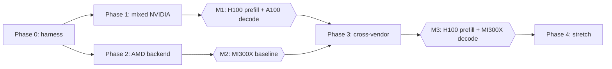

# Proposal: Heterogeneous inference (NVIDIA + AMD)

2026-11-03 · Aditya

## How to file this

File the four **Parent issue** sections as one umbrella issue, then file each numbered sub-issue under it: the heading is the issue title, the text under it is the body. Numbers here are local; set each sub-issue's "blocked by" from the plan table and swap in real issue numbers as you go.

Suggested labels: `hetero-inference`, `phase-0` to `phase-4`, `backend/amdgpu`, `milestone`.

## Parent issue: summary and motivation

**Title:** Heterogeneous inference: prefill on NVIDIA, decode on AMD, with a compile-time placement proof

Vx should serve one model across NVIDIA and AMD GPUs, with prefill on H100 and decode on MI300X, and vxc proving before launch that the placement fits. This is the workload where memory spaces and device topology as types stop being nice to have and become the reason the system works.

**Why this workload**

- Prefill is compute-bound and decode is memory-bandwidth-bound, so running them on different hardware is the obvious cost lever. MI300X's 192 GB of HBM3 makes it a natural decode tier.
- The industry already splits phases across vendors, but by hand. AWS pairs Trainium prefill with Cerebras for decode. HMA-Serve glues a Tenstorrent prefill mesh to vLLM decode on an A100. A multi-vendor prefill/decode paper needed a dedicated module just to reconcile how vendors manage GPU memory.
- The production disaggregation stacks we found target one vendor's fleet at a time (NVIDIA Dynamo, AMD Infera). None of them tell you before deploy whether a mixed placement fits.

**What Vx brings**

- KV cache crossing a device boundary is a typed value. Layout, dtype and memory space are in the type, so a mismatch is a compile error, not corrupted output.
- Transfers compile only along links the cluster topology declares.
- Admission checks every device's memory and every link's bandwidth against the target load, and explains a rejection before anyone rents hardware.

**References**

- [Disaggregation Makes KV Cache a System Primitive](https://www.gomomento.com/blog/disaggregated-prefill-and-decode/) (Momento): AWS Trainium prefill with Cerebras decode
- [HMA-Serve](https://api.emergentmind.com/topics/hma-serve): Tenstorrent p150 prefill, A100 decode
- [Disaggregated prefill and decoding on multi-vendor GPUs](https://api.emergentmind.com/papers/2509.17542) (arXiv 2509.17542)
- [AMD ROCm Infera](https://rocm.blogs.amd.com/software-tools-optimization/infera-di/README.html)
- [HexGen-2](https://arxiv.org/pdf/2502.07903): disaggregated serving on heterogeneous GPUs

## Parent issue: goals, non-goals, success criteria

This is done when one model serves with prefill on H100 and decode on MI300X, `vxc check` explains the placement, and the cost result is published whichever way it lands.

**Goals**

- Type-checked cluster topology spanning NVIDIA and AMD devices and the links between them
- Admission (`vxc check`) over multi-device placements, with readable rejections
- An AMDGPU backend good enough to run decode for the target model on MI300X
- A minimal disaggregated runtime, plus a benchmark that reports $ per million tokens at a fixed SLO

**Non-goals**

- Tensor or pipeline parallelism across vendors. Within a tier, all devices are one vendor.
- Vulkan, SYCL or other backends in this effort
- Drop-in vLLM API compatibility beyond a minimal OpenAI-style endpoint for benchmarking
- Beating vLLM or SGLang on single-vendor throughput (welcome, not required)
- Training, multi-model or LoRA serving

**Success criteria**

- [ ] `vxc check` accepts and rejects mixed NVIDIA + AMD cluster specs; each rejection names the device or link, the constraint and the shortfall
- [ ] Verdicts agree with what actually fits or runs out of memory on real hardware
- [ ] Prefill on H100 with decode on MI300X passes the cross-vendor correctness thresholds (#15)
- [ ] $ per million tokens at a fixed SLO published against homogeneous H100 and MI300X baselines, with configs, prices and dates
- [ ] Every milestone reproducible from repo docs on rented hardware

## Parent issue: plan

Phases 1 and 2 run in parallel, and cross-vendor work starts once both M1 and M2 land. Phase 2 (the AMD backend) is self-contained enough to be an outside contributor's track.



| # | Sub-issue | Phase | Blocked by |
| --- | --- | --- | --- |
| 1 | Benchmark and correctness harness | 0 | glm-vx GPU bring-up |
| 2 | Cluster topology types | 1 | none |
| 3 | Typed paged KV cache | 1 | 2 |
| 4 | Multi-device admission and `vxc check` | 1 | 2, 3 |
| 5 | Typed KV transfer on NVIDIA | 1 | 2, 3 |
| 6 | Disaggregated prefill/decode runtime | 1 | 1, 4, 5 |
| 7 | M1: H100 prefill + A100 decode | 1 | 6 |
| 8 | AMDGPU target and ROCDL lowering | 2 | none |
| 9 | HIP runtime | 2 | 8 |
| 10 | MI300X SKU and CDNA memory model | 2 | 2 |
| 11 | Core inference kernels on AMD | 2 | 8, 9, 10 |
| 12 | M2: MI300X baseline and AMD CI | 2 | 1, 11 |
| 13 | Cross-vendor KV format and conversions | 3 | 3, 11 |
| 14 | Cross-vendor KV transport | 3 | 5, 9, 13 |
| 15 | Cross-vendor numerical validation | 3 | 1, 13 |
| 16 | M3: H100 prefill + MI300X decode | 3 | 7, 12, 14, 15 |
| 17 | `vxc plan`: placement search | 4 | 4, 16 |
| 18 | Scheduler hardening | 4 | 16 |

## Parent issue: risks and open questions

The biggest risk is the network between vendors, not the compiler: H100 and MI300X rarely share a chassis or an RDMA fabric on rental clouds.

**Risks**

- **Network between vendors.** M3 likely starts over TCP between two rented machines. Long prompts will pay for that, so report transfer overhead separately rather than folding it into averages.
- **AMD kernel maturity.** Use hipBLASLt for GEMM first, so M2 and M3 test placement rather than kernel heroics. Native MFMA kernels follow.
- **Numerics.** Prefill and decode on different vendors won't be bit-identical. Thresholds are fixed in #15 before M3, not after seeing results.
- **The split may not pay for every workload.** Short prompts can lose to transfer cost. Admission saying so is a feature; the write-up should show where the crossover is.
- **Scope creep.** The runtime stays minimal; anything not needed for M1 to M3 moves to Phase 4.
- **AMD CI cost.** Nightly correctness and weekly performance runs, with a spend cap.

**Open questions**

- [ ] Which model and size for M1 to M3? Proposal: whatever glm-vx runs, sized so each tier fits on one device.
- [ ] Where does the runtime (#6) live: `vx-lang/Vx` examples, glm-vx, or its own repo?
- [ ] Transport for #14: UCX, the Mooncake transfer engine, or MoRI-IO (AMD Infera uses the last two)?
- [ ] MI300X (gfx942, FNUZ FP8) first, or MI355X (gfx950, OCP FP8)?
- [ ] Does M1 get its own public write-up, or wait for M3?

______________________________________________________________________

## Sub-issues, Phases 0 and 1: harness and mixed NVIDIA

### 1. Benchmark and correctness harness

One harness every milestone reports through, so M1, M2 and M3 numbers are comparable.

- [ ] Fixed prompt set with reference outputs from HF transformers (BF16) for the target model
- [ ] Correctness modes: greedy token match against the reference, and teacher-forced next-token comparison (top-1 agreement, mean KL) so one early divergence doesn't compound
- [ ] Load generator against an OpenAI-compatible endpoint, with three workload mixes: short chat, long prompt with short answer, long generation
- [ ] Metrics: TTFT and inter-token latency (p50, p99), throughput, goodput at a stated SLO
- [ ] Cost: $ per million output tokens from the hourly rental price, with provider and date recorded in the results
- [ ] Same harness drives SGLang and vLLM baselines

**Done when:** one command produces a results file for Vx and for a baseline on the same hardware.

**Blocked by:** glm-vx GPU bring-up (existing issue)

### 2. Cluster topology types

Extend device topology types from one machine to a cluster of unlike devices.

- [ ] Device kinds carry vendor and architecture (sm_80, sm_90, gfx942)
- [ ] Memory spaces per device (HBM, host pinned, remote) with capacity in the type
- [ ] Links as types with kind (NVLink, PCIe, xGMI, RDMA, TCP) and bandwidth
- [ ] Cluster spec composed from SKU descriptions plus links, parsed and type-checked by vxc
- [ ] A value in one memory space cannot be used from another without an explicit transfer

**Done when:** an H100 + A100 spec and an H100 + MI300X spec type-check, and touching decode-side memory from prefill code is a compile error.

**Blocked by:** none

### 3. Typed paged KV cache

KV cache becomes a first-class type whose layout, dtype, page size and memory space are part of the type.

- [ ] KV type parameterized by model shape (layers, KV heads, head dim), dtype, page size, layout and memory space
- [ ] Page table and block allocator per memory space
- [ ] Layout and dtype conversions are explicit functions; mismatched KV types don't unify
- [ ] BF16 first, FP8 behind a flag

**Done when:** prefill writes and decode reads KV through the type, and a layout or dtype mismatch fails at compile time.

**Blocked by:** #2

### 4. Multi-device admission and `vxc check`

Extend z3 admission from one device to a placement across a cluster spec.

- [ ] Per device: weights + KV at target concurrency × max context + workspace + runtime reserve ≤ usable capacity
- [ ] Per link: KV bytes per request ÷ link bandwidth fits the TTFT budget, and aggregate KV bytes/s at target QPS ≤ link bandwidth
- [ ] KV bytes per token = 2 × layers × KV heads × head dim × bytes per element
- [ ] `vxc check <program> --cluster <spec>` prints accept or reject
- [ ] Unsat core translated into a readable reason: constraint, device or link, required vs available

Example rejection (illustrative):

```
REJECT  decode tier (A100-40GB): KV for 64 seqs × 32k ctx needs <X> GiB; <Y> GiB usable
```

**Done when:** verdicts agree with measured fit or out-of-memory on at least five real configurations, including one near the boundary.

**Blocked by:** #2, #3

### 5. Typed KV transfer on NVIDIA

Moving KV between memory spaces is a typed operation, and only paths the topology declares compile.

- [ ] Intra-node: CUDA peer copies over NVLink or PCIe
- [ ] Cross-node: host-staged TCP first, then GPUDirect RDMA through the transport chosen in open questions
- [ ] Layer-by-layer streaming so transfer overlaps prefill compute
- [ ] Measured link bandwidth written back into the cluster spec

**Done when:** KV for a 4k-token prompt moves H100 → A100 and decode output matches same-device decode within the harness tolerance.

**Blocked by:** #2, #3

### 6. Disaggregated prefill/decode runtime

A minimal runtime: router, prefill workers, decode workers and the KV handoff between them.

- [ ] Request lifecycle: route → prefill → transfer → decode → stream
- [ ] Continuous batching over paged KV on the decode side
- [ ] Backpressure when the decode KV pool is full
- [ ] Minimal OpenAI-compatible endpoint (completions with streaming) for the harness
- [ ] Placement read from the cluster spec that `vxc check` accepted

**Done when:** the harness runs end to end against it on one machine with two GPUs.

**Blocked by:** #1, #4, #5

### 7. M1: H100 prefill + A100 decode

First public demo, on mixed NVIDIA generations with today's single backend.

- [ ] Rent H100 + A100 and run the harness
- [ ] Baselines at the same SLO: SGLang on 2× H100 and on 2× A100
- [ ] Rejection demo: raise max context until `vxc check` refuses, and show the reason before any hardware is rented
- [ ] Write-up with configs, prices and dates

**Done when:** results are published, whichever way they come out.

**Blocked by:** #6

______________________________________________________________________

## Sub-issues, Phase 2: AMD backend

### 8. AMDGPU target and ROCDL lowering

Give vxc a second GPU target by enabling AMDGPU in the bundled LLVM and lowering kernels through MLIR's ROCDL dialect.

- [ ] Add AMDGPU to `LLVM_TARGETS_TO_BUILD`, plus lld, in the bundled llvm-project (#1269); confirm developer build time is unchanged and record the install-size delta
- [ ] Lower GPU kernels through ROCDL, mirroring the NVVM path, with `gfx942` as the first target
- [ ] Emit HSA code objects through LLVM's AMDGPU backend and lld, so no external assembler is involved
- [ ] Target selection in vxc per device, driven by the cluster spec

**Done when:** a vector add and a tiled GEMM written in Vx compile to a `gfx942` code object.

**Blocked by:** none

### 9. HIP runtime

Run AMD code objects behind the same device-runtime interface the CUDA path uses.

- [ ] Module load, kernel launch, streams, events and allocation through HIP
- [ ] Load the ROCm runtime at run time, so vxc binaries still start on machines without ROCm
- [ ] Device discovery reports vendor and architecture into the topology types

**Done when:** the kernels from #8 run on an MI300X and pass their tests.

**Blocked by:** #8

### 10. MI300X SKU and CDNA memory model

Describe MI300X precisely enough for admission to give verdicts that match reality.

- [ ] SKU description: 192 GB HBM3 capacity, bandwidth, CU count, LDS per CU, wave64
- [ ] CDNA memory spaces (HBM, LDS) expressed in the type system
- [ ] Measured usable HBM after runtime reserve, not only datasheet numbers

**Done when:** `vxc check` gives a verdict for a single-MI300X spec that matches measured fit.

**Blocked by:** #2

### 11. Core inference kernels on AMD

Every kernel the target model needs, correct first and fast second.

- [ ] GEMM: hipBLASLt first, then a Vx-native MFMA GEMM
- [ ] Paged decode attention for wave64
- [ ] Prefill attention, needed for the single-device baseline in #12
- [ ] RMSNorm, RoPE, activations and sampling
- [ ] Each kernel checked against the NVIDIA implementation's outputs within tolerance

**Done when:** one full decoder layer of the target model matches the reference on MI300X.

**Blocked by:** #8, #9, #10

### 12. M2: MI300X baseline and AMD CI

The target model end to end on a single MI300X, measured the same way as M1.

- [ ] Target model through the harness on one MI300X
- [ ] Baseline: vLLM or SGLang on ROCm, same GPU, same SLO
- [ ] CI on rented MI300X: nightly correctness, weekly performance, with a spend cap

**Done when:** correctness passes and numbers are published next to the ROCm baseline.

**Blocked by:** #1, #11

______________________________________________________________________

## Sub-issues, Phase 3: cross-vendor

### 13. Cross-vendor KV format and conversions

Define one KV wire format both vendors convert to and from, with every conversion explicit in the types.

- [ ] Canonical wire format: page size, head-major or token-major order, alignment
- [ ] BF16 first
- [ ] FP8: Hopper uses OCP E4M3FN and MI300-series uses E4M3FNUZ, so this is a typed conversion, never a reinterpret cast
- [ ] Conversions fused into the send and receive paths where possible

**Done when:** BF16 KV produced on H100 decodes on MI300X (via a host round-trip) within the harness tolerance. FP8 is tracked as a follow-up.

**Blocked by:** #3, #11

### 14. Cross-vendor KV transport

Move KV from an NVIDIA prefill node to an AMD decode node, first simply and then fast.

- [ ] Host-staged TCP path first, for correctness between any two rented machines
- [ ] RDMA path: GPUDirect RDMA on NVIDIA and ROCm peer memory on AMD, through a transport that supports both (see open questions)
- [ ] Layer-by-layer streaming, overlapped with prefill
- [ ] Measured link bandwidth written back into the cluster spec

**Done when:** KV moves H100 → MI300X over both paths, and admission's predicted transfer time is within 20% of measured.

**Blocked by:** #5, #9, #13

### 15. Cross-vendor numerical validation

Agree on what "correct" means across vendors before M3, not after.

- [ ] Teacher-forced comparison of H100 only, H100 → MI300X, and MI300X only on the harness prompt set
- [ ] Thresholds for top-1 agreement and mean KL, written down before M3 runs
- [ ] Regression test in CI

**Done when:** thresholds are documented and met for BF16.

**Blocked by:** #1, #13

### 16. M3: H100 prefill + MI300X decode

The headline demo: one model, two vendors, a placement proof, and the cost result.

- [ ] `vxc check` accept and reject on the mixed spec, with the rejection reason shown
- [ ] End to end through the harness, passing the #15 thresholds
- [ ] Baselines at the same SLO: SGLang on 2× H100, a ROCm engine on 2× MI300X
- [ ] $ per million tokens published with configs, prices and dates; transfer overhead reported separately

**Done when:** results are published, whichever way the numbers land.

**Blocked by:** #7, #12, #14, #15

______________________________________________________________________

## Sub-issues, Phase 4: stretch

### 17. `vxc plan`: placement search

Turn admission from a yes/no check into a planner that picks the placement.

- [ ] Given a model, an SLO, and a menu of SKUs with hourly prices, use z3 Optimize to propose the cheapest placement and prefill:decode ratio that admission accepts
- [ ] Explain why the runner-up placement lost

**Done when:** the planner's pick matches or beats the hand-picked M3 placement on $ per million tokens.

**Blocked by:** #4, #16

### 18. Scheduler hardening

The runtime features needed beyond a demo.

- [ ] Adjust the prefill:decode ratio as load changes
- [ ] Prefix cache reuse across requests
- [ ] Decode-node loss triggers re-prefill elsewhere
- [ ] Runtime admission: refuse requests that would break the accepted placement

**Done when:** a load-shift test and a decode-node kill test both complete without dropped requests.

**Blocked by:** #16
